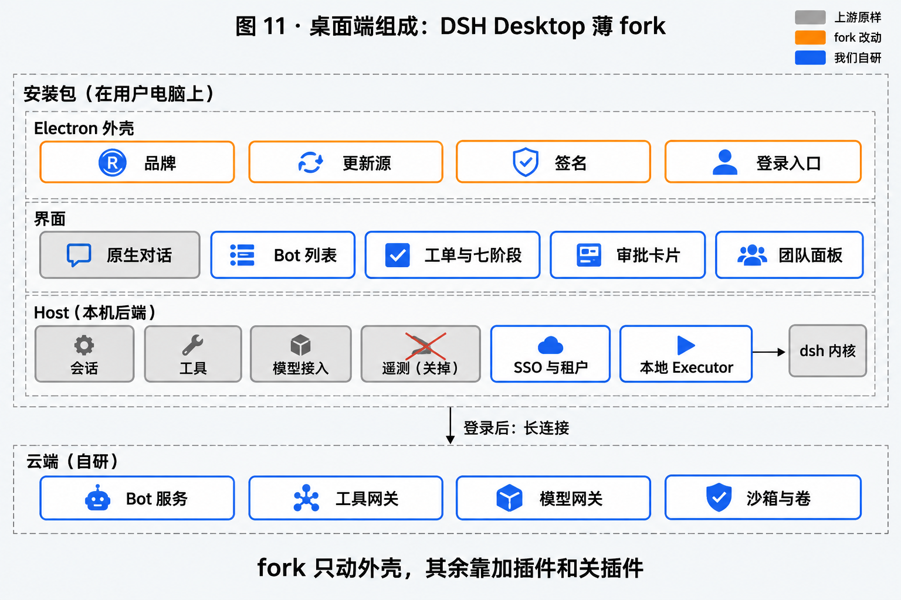
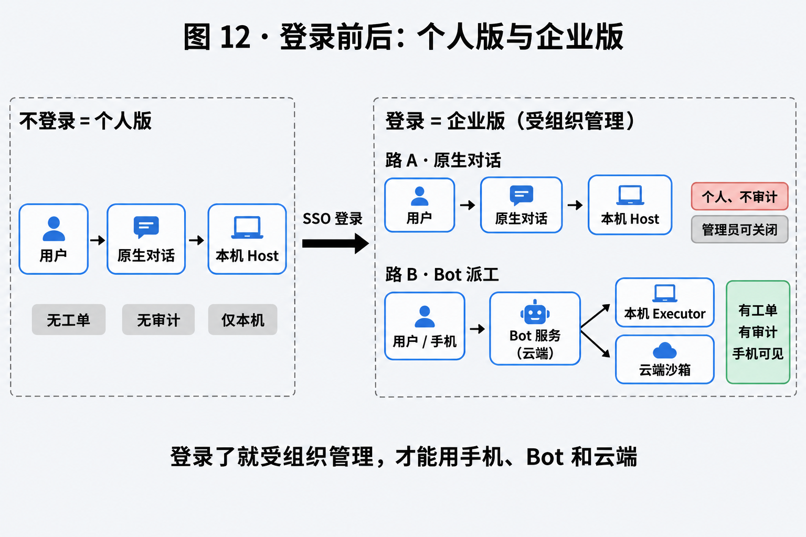
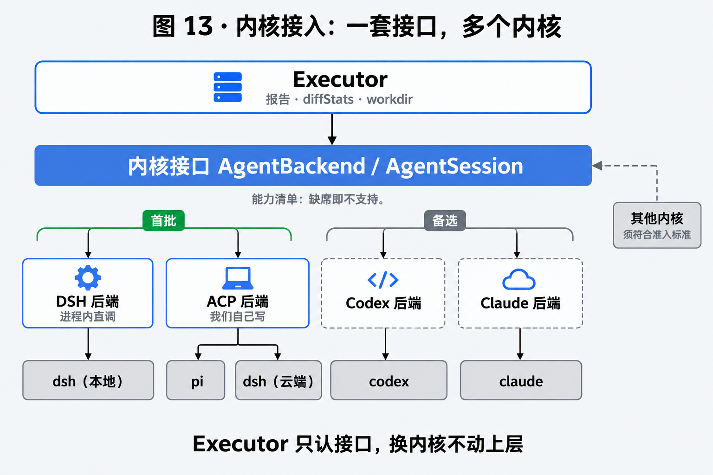
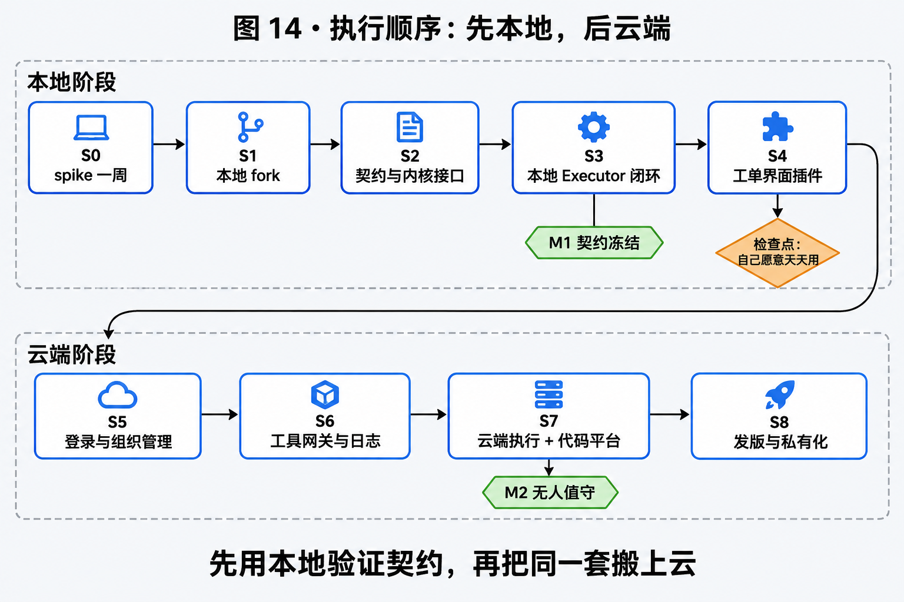
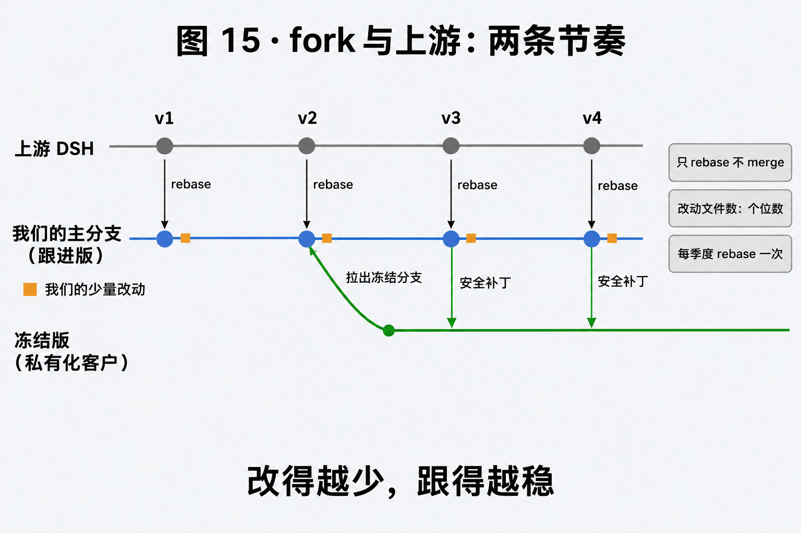

# SiriusX

## 产品定义

一个安装包：**DSH Desktop 薄 fork**（品牌、更新源、签名、登录入口）。

- **个人版** = 不登录。就是这个安装包本身，Host 是 DSH 自带的。
- **企业版** = 同一个安装包，SSO 登录后多出四样：
  1. Host 侧扩展（SSO、租户上下文、本地 Executor）
  2. 我们的界面插件（团队面板、审批卡片、Source 配置）
  3. 自研云端（沙箱、卷）
  4. Bot 服务（Engine、准入、网关、审计）

前两样装在桌面端里，后两样是独立的云端服务，与 DSH Desktop 无关。

## 登录即受组织管理

登录是一条分界线：登录了就受组织管理，才能用手机、Bot 和云端。

登录后桌面端有两条路让 agent 干活，两条都保留：

| | 原生对话 | Bot 派工 |
| --- | --- | --- |
| 路径 | 界面 → 本机 Host | 云端 Bot → ACP → 本机 Host，或云端沙箱 |
| 工单、阶段、审计、用量 | 没有 | 有 |
| 手机可见、可控 | 否 | 是 |
| 界面标识 | 明确标为「个人、不审计」 | — |

- 租户管理员可以关闭登录状态下的原生对话。
- 已知边界：这个开关只管登录状态。用户退出登录后就是个人版，原生对话仍在；要彻底禁止需要靠设备管理手段，不在本产品范围内。

## 工单界面

工单、Bot 列表、审批卡片、团队面板全部做成 **DSH 插件**，挂在 DSH Desktop 的界面槽位里，不另做独立应用。

待定：纯浏览器端与手机端没有本机 Host，这套插件界面在它们上面怎么提供（见待验证第 5 条）。

实施状态与剩余验收项见 [docs/status.md](docs/status.md)；当前待办见 [TODO.md](TODO.md)；外部资源/真机验收步骤见 [docs/manual-acceptance.md](docs/manual-acceptance.md)。

## 仓库布局

```text
siriusx/
  deepseek-harness/   # DSH 源码 fork 的本地 checkout（独立 Git，upstream remote；不随本仓库提交）
  plugins/            # DSH 插件，与 DSH 源码同级；不塞进上游 packages/
  packages/           # 非插件共享代码：契约、内核接口、Executor、analytics
  apps/               # 控制面、工具网关、autobot 等独立应用
  deploy/             # 单机 / 私有化部署
  evidence/           # 各步骤验收证据
```

DSH 插件必须是独立 package；能用插件或独立 package 完成的能力，不进入 fork。

## 当前实现状态（滚动更新）

- S0：完成。
- S1：fork、遥测关闭、源码构建、离线会话、10 分钟零外联抓包、clean clone install/typecheck/test 完成；Desktop 实际启动需 mac/win，5 天使用待真实时间。
- S2：契约、内核接口、DSH adapter、假内核、BG1 场景完成。
- S3：本地 Executor、Host 插件、SQLite Bot 服务、真实 DSH AgentLoop、previews/TTL、真实进程 kill、lost resume、sandbox reaper 完成。
- S4：四个独立 Team UI package、审批/打断 UI、同工单阶段/报告完成；10 天真实使用待补。
- S5：OIDC Host provider、租户控制面、设备配对、长连接网关、模型网关、Desktop 企业 gate、native/Docker/断网容器安装完成；真实 IdP/KMS 与全服务干净机待补。
- S6：工具网关、审批/审计、analytics、local_dir 上行过滤、Vault KV v1/v2、完整 ticket trace 完成；真实 KMS/Vault、真实抓包待补。
- S7：CloudExecutor、Docker 沙箱隔离/卷/资源限额/allowlist、真实 dsh+pi（含 sandbox）、内核对齐、repo clone、GitHub connector/mock Issue→MR 完成；真实平台 Issue→MR 与 M2 真实 crash 待补。
- S8：SiriusX 品牌/图标、electron-builder 参数、离线 tar、DSH Web 离线镜像、全栈 Compose、internal 网络与断网容器安装、patch backport 完成；mac/win 签名安装、自动更新与真实客户 30 天待补。
- S9：DSH Web + Team 插件、HttpOnly Web Gateway、浏览器 OIDC（本地 IdP）、Web 审批、云端项目发起/打断、同工单跨接入模式一致完成；真实企业 IdP/真实 agent 待补。
- S10：390×844 响应式 Team、手机审批→等待 task resume、配对设备远程 local_dir 发起/跟进/打断完成；iOS/Android 真机、真实 agent 联调待补。

## 本地开发与验证

```bash
corepack prepare pnpm@11.28.5 --activate
pnpm install
pnpm typecheck
pnpm test
```

`deepseek-harness/` 是独立 Git checkout，不随本仓库提交；需要验证 DSH 集成时单独 clone 并安装依赖。

可选 headless 对话 smoke（需要本机安装 `pi`）：

```bash
./scripts/smoke-pi-conversation.sh
```

## 发布前本地门禁

```bash
./scripts/release-check.sh
```

会依次跑 typecheck、test、fork discipline、安装覆盖、插件 bundle、更新 feed 语法检查、脚本可移植性检查、依赖清单、CycloneDX SBOM、许可证策略检查和发布清单。

## 魔改纪律

- 只 fork 桌面外壳（`apps/desktop`），不改 agent 内核。
- 能用插件或独立 package 做的，不进 fork；fork 里改动的文件数控制在个位数。
- 上游单独一个 remote，我们的分支只 rebase 不 merge，每季度一次。
- 私有化客户用冻结版本，我们自己 backport 安全补丁；其余用户跟上游。

## 发版前必办

1. **审掉上游自带的遥测与日志上报。** 逐个查清默认是否开启、发往哪里，关掉或改指向我们自己的端点：`dsh-host-product-telemetry-otel`、`dsh-client-product-analytics`、`dsh-session-telemetry-otel`、`dsh-session-log-deepseek`、`dsh-anonymous-user-id`。我们承诺「内容默认只属于租户」「私有化数据不出客户网络」，漏一个就是合规事故。
2. **品牌换干净。** MIT 允许改和卖，但不授予商标。去掉官方品牌（`dsh-client-ui-brand-official`）与官方账号入口（`dsh-deepseek-account`）。
3. **企业插件打进安装包。** DSH 装插件要联网用 pnpm 拉包，内网客户做不到；所以插件随安装包分发，登录只是「启用」而不是「下载」。
4. **权限只在服务端判定。** 插件都在本机，用户有办法不登录就打开团队面板，所以界面只负责显示，鉴权与数据全部由 Bot 服务决定。

## 执行内核怎么接

内核接入标准是一套与内核无关的接口：`AgentBackend`（检测、打开会话）、`AgentSession`（历史、订阅、提交、取消、释放）、`AgentEvent`（统一事件）、`SessionCapabilities`（能力清单，缺席即不支持）。接口取自 [dsh-TUI](https://github.com/ccch1mneyyy/dsh-TUI)（MIT）的 `src/agent/`，拷入本仓自己维护，不作为依赖。Executor 只面向这套接口，把 `AgentEvent` 映射成契约事件的代码只写一份。**S0 已验**：接口可以干净拆出，但 dsh-TUI 的 DSH 后端不能原样复用；DSH 适配器由我们按公共 `Agent`/`session/event` API 自研，见 [S0 spike](docs/spike.md)。

| 批次 | 内核 | 怎么接 |
| --- | --- | --- |
| 首批 | dsh | 本地：Host 进程内调用，经**自研的 DSH in-process adapter**（不复用 dsh-TUI 的 DSH 后端）。云端：经下面的 ACP 后端连 `dsh --profile acp` |
| 首批 | pi | 经 ACP 后端 |
| 备选 | codex、claude | dsh-TUI 已有实现，需改成无人值守，并确认能指向租户模型网关 |
| 其他 | — | 必须符合准入标准 |

**ACP 后端**是我们自己要写的唯一一个后端：一个符合 `AgentBackend` 的 ACP 客户端，后端标识 `acp:<agent>`。任何会说 ACP 的 agent 都经它接入。

| 接口 | ACP |
| --- | --- |
| `open` 新建 / 恢复 | `session/new` / `session/resume` |
| `submit` | `session/prompt`（一个会话同时只收一个；运行中的追加输入由后端排队，打断 = 先取消再提交） |
| `cancel` | `session/cancel` |
| `subscribe` | `session/update` |
| 状态「等待人处理」 | `session/request_permission` |
| 能力清单 | 只声明 ACP 给得出的：审批、模型、推理强度；不声明分叉、回退、历史回放 |

**准入标准**（其他内核想接入）：实现接口；如实声明能力清单；通过同一套场景测试；满足最低能力门槛（门槛待定，云端内核至少要有审批与自定义模型端点）；会话记录能放到家目录卷上（云端每次派工都是新沙箱，续跑靠卷里的会话记录）。

**已知代价**：本地直调 dsh 用的是 DSH 内部接口（`dsh-agent`、`dsh-session`），不是对外协议，上游升级时最容易变；而且上游把 DSH 特殊对待，它本身不是 `AgentBackend`，需要我们自己的 in-process wrapper。对策：用录制的会话日志做回归，每次升级 DSH 跑一遍；成本不可接受时，本地也改经 ACP 后端（Host 里挂 `dsh-acp`），Executor 只认接口，上层不受影响。

不在这套接口里、由 Executor 自己做的：结构化报告（`ready` / `answer` / `blocked`）、`diffStats`、workdir、预览。

Desktop 自己的界面仍然直连 Host，与 Executor 无关。

## S0 已验证与后续待验证

**S0 已完成（2026-11）**，结论与施工图见 [docs/spike.md](docs/spike.md)：

1. **SSO 走应用层 account seam，不改 Host 传输认证。** `deepseekAccount` 可由企业 provider 替换；`client-connection` 的 launch-token Cookie 是本地传输凭据，不应改成 SSO。
2. **租户上下文在 Host 内产生。** OIDC 回调解析 tenant/subject，由 Host service 提供给 Executor 与界面插件，不经过 Electron session 或 Web Cookie。
3. **Executor 与界面可同 Host 并存，但必须单写者。** 同一 live Agent 共享 durable inbox；第二个独立 `resume()` 会被拒绝。Bot 管理的 Session 中界面只能经 Bot 打断/续跑。
4. **只复用 dsh-TUI 接口，不复用 DSH 后端。** 12 文件接口空包 tsc 通过；DSH 后端提取会拖入 237 个本地文件和大量 TUI/Ink 依赖。

产出：`docs/spike.md` 与 `evidence/S0/`；S1–S5 的 fork 施工图需改 9 个文件（2 新增、7 修改），品牌/签名等 S8 工作另计。

**用到之前再验**：

- 云端执行（S7）之前：`pi-acp` 是否支持我们要用的调用：建会话、恢复、取消、审批（版本尚在 0.0.x，未读过实现）。
- 云端执行（S7）之前：这套接口能否支撑契约要求的 `backgrounded` 状态与 `activity` 事件字段；经 ACP 后端接入的内核（pi、云端 dsh）在这两项上会缺什么。
- Web 与手机端开工之前：Web 与手机端怎么用上插件形式的工单界面：DSH 的 `web` profile 能否在云端按用户提供同一套前端，还是这两端另行处理。

## 图











## 文档

- [架构总览](docs/architecture.md)
- [任务步骤书](docs/plan.md)：从 fork 到全平台的逐步任务与验收标准
- [路线图与决议](docs/roadmap.md)（桌面端与内核接入见 #56、#57，登录与工单界面见 #58、#59，发版前必办见 #60，**执行顺序见 #61，S0 结论见 #62**）
- [S0 Spike 结论与施工图](docs/spike.md)
- [Executor 契约](docs/contracts/executor.md)
- 设计文档见 `docs/design/`
