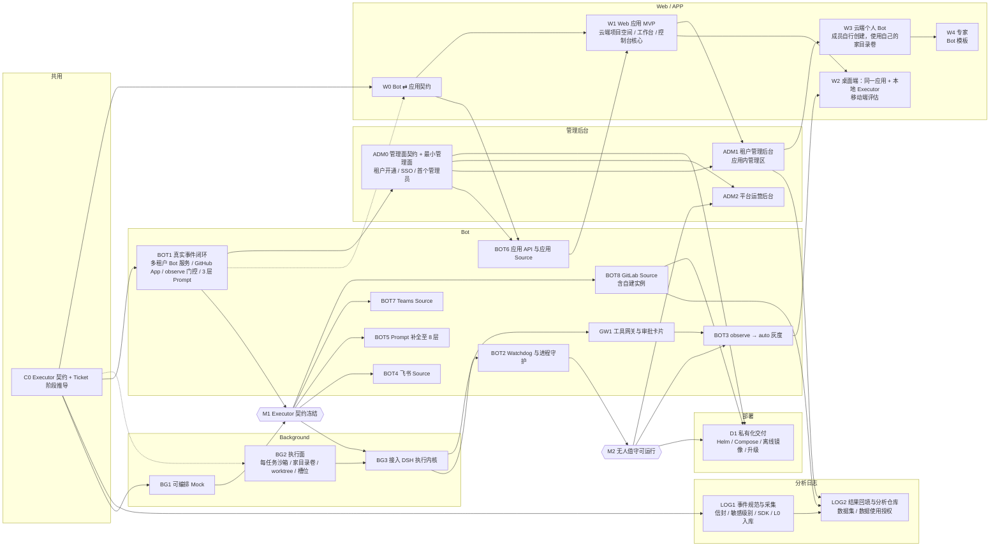

# 落地路线

> 总览见 [architecture.md](./architecture.md)，各模块设计见 `design/`。

## 原则

1. **先让接口在真实数据流中定型，再填充实现**。Background 先只提供可编排的 Mock，沙箱细节等接口稳定后再做，避免 Executor 接口凭想象设计、接上 Bot 后返工。
2. **契约是同步点，实现按模块并行**。每个模块只依赖对方的契约，不依赖对方的实现；契约未定时不并行。

## 执行顺序（当前版本）

> **S0 已完成（2026-11），结论与施工图见 [spike.md](./spike.md)，下一步 S1。**
>
> roadmap #61。#56–#60 之后的顺序，**取代**下面「依赖图」「按人手排期」里的先后关系；节点详情里的内容与验收仍可参考，W1、W2 待 W0/BOT1 定型后按 S0 结论重写。

专家原来的顺序是「云端沙箱 → Bot → 应用」，桌面端排在倒数第四。现在产品本体是 DSH Desktop 的薄 fork，个人版就是它本身，所以**倒过来：先本地，后云端**。理由：

- 云端沙箱要解决调度、家目录卷、出口白名单、卷并发挂载，全是硬工程，但一个都不影响契约；契约规定本地与云端两种实现的状态机、事件语义相同，用本地实现验证契约，效果一样，成本低一个数量级。
- 个人版自己每天能用，用不下去就说明产品有问题，这个信号几周内就能拿到；企业版要很久才见得到真实反馈。

| 步 | 做什么 | 做完能证明什么 | 对应原节点 |
| --- | --- | --- | --- |
| **S0** | **spike**（1 周），只验会挡住 S1–S5 的四条：Host 认证能否换成 SSO；租户上下文怎么进 Host；Executor 插件与界面能否在同一个 Host 里并存；内核接口与 DSH 后端能否拆出来。产出施工图 | 「同一个安装包，登录后变企业版」这个前提是否成立；后面各步的工作量 | — |
| **S1** | **DSH Desktop 本地 fork（最小版）**：建上游镜像与我方分支；能从源码构建并运行；关掉上游遥测。**不做**品牌、签名、更新源 | 个人版自己每天在用。fork 的改动文件数与 rebase 成本有了实数 | W2 的一部分 |
| **S2** | **契约与内核接口**：`executor.md` §8 落成代码并补齐缺的 schema；分析事件的字段与 L0 / L1 / L2 级别标注一并定下；拷入 `AgentBackend` 接口与 DSH 后端；场景剧本（可编排 Mock） | 契约从文档变成可运行的类型与测试 | C0、BG1、LOG1 的 schema 部分 |
| **S3** | **本地 Executor 与本机闭环**：Executor 作为 Host 内的插件实现 `local_dir`；Bot 服务以单租户、SQLite 的形态跑在本机来派工（同一份代码，S5 只是换部署位置） | 派工 → 执行 → 报告 → 打断 → 续跑。**契约在真实数据流中冻结（M1）** | BOT1 的最小版、W2 的一部分、M1 |
| **S4** | **工单界面插件**：Bot 列表、工单与七阶段、审批卡片，挂进 DSH Desktop 的界面槽位 | 连续用它做自己的真实工作 | W0、W1 |
| ◆ | **检查点**：自己愿意天天用才往下走；用不下去就回头改 S2–S4，不往后投入 | — | — |
| **S5** | **登录与组织管理**：SSO 与租户上下文进入 Host；Bot 服务上云并支持多用户；设备配对；管理员开关（含关闭原生对话）；**入口网关与租户模型网关的最小版** | 登录前是个人版，登录后受组织管理 | ADM0、BOT6、#58 |
| **S6** | **工具网关与日志采集**：策略、审批、审计、凭据托管；按 S2 定下的字段采集分析事件 | 允许 agent 经企业连接器对外写入之前必须完成，不得延后 | GW1、LOG1 的采集部分 |
| **S7** | **云端执行与第一个代码平台**：ACP 后端；沙箱与家目录卷；云端 dsh 与 pi；第一个代码平台 Source（GitLab 或 GitHub，按首个客户定）。开工前先验三条：`pi-acp` 是否够用、ACP 接入的内核在 `backgrounded` 与 `activity` 上缺什么、家目录卷并发挂载方案 | 团队 Bot 能接手真实的 Issue 与评审。**无人值守可运行（M2）** | BG2、BG3、BOT2、BOT8 或 GitHub Source |
| **S8** | **发版与私有化交付**：品牌、签名、更新源、企业插件打进安装包（#60）；整套装进一个客户内网，版本冻结 | 一个真实客户连续使用 | D1、W2 的打包部分 |
| 之后 | 其余 Source（飞书、Teams、另一个代码平台）、租户后台与运营后台、结果回填、observe → auto 灰度、个人 Bot 的记忆与模板、Web 与手机端 | — | BOT3/4/5/7、ADM1/2、LOG2、W3、W4 |

贯穿各步的三条规则：

1. **从 S5 起，整套系统始终能单机一体安装。** S3 的本机 Bot 已经是这个形态，之后每加一个服务都保持它。这样 S8 是拿真实客户验证，不是到最后才第一次组装。
2. **S6 不能排到 S7 之后。** 云端一旦能跑团队 Bot 就会有对外写入，网关必须先到位。
3. **不提前做发版工作。** 品牌、签名、更新源在对外分发前才做（S8）；提前做只会在每次 rebase 时多一份负担。

未定的两件事：

- **S5 的轻重取决于 S0。** 如果 SSO 只是替换 Host 里的一块，S5 不大；如果要改 Host 源码，它会变成最重的一步，可能要拆开。
- **Web 与手机端排在最后且未定方案**（#59 的待定项）。「登录了才能用手机」要到这一步才兑现；开工前先验 DSH 的 `web` profile 能否在云端按用户提供同一套前端。

## 依赖图

> 以下依赖图与「按人手排期」是 #56 之前的版本，先后关系以上面的「执行顺序」为准。

箭头表示「完成后才能开始」，虚线表示「可以先用假数据或预研开工，正式接入要等前置完成」。六边形是里程碑。

### 按模块归属

| 模块 | 节点 |
| --- | --- |
| 共用 | C0 |
| Background | BG1 → BG2 → BG3 |
| Bot | BOT1 → BOT2 → BOT3；BOT8、BOT4、BOT7、BOT5（M1 之后，按此优先级）；BOT6；GW1（BG3 之后、BOT3 之前） |
| Web / APP | W0 → W1 → W2；W3（ADM1 之后）→ W4 |
| 部署 | D1（M2、BOT8 与 ADM0 之后） |
| 管理后台 | ADM0（BOT1 之后、BOT6 之前）→ ADM1（W1 之后）；ADM2（M2 之后，SaaS 开放多租户之前） |
| 分析日志 | LOG1（C0 之后，与 BOT1、BG3 并行）→ LOG2（ADM1 与 BOT8 之后） |

### 按人手排期

| 人手 | 排法 |
| --- | --- |
| 1 人 | 按拓扑序串行：C0 → BG1 → BOT1 → M1 → LOG1 → BG2 → BG3 → BOT2 → M2 → W0 → ADM0 → BOT6 → W1 → ADM1 → BOT3 → BOT8 → LOG2 → D1 → BOT4 / BOT7 / BOT5 → W2 → W3 → W4 → ADM2（SaaS 对外开放多租户前必须完成）。BG2 可以在 BOT1 的空档里预研 |
| 2–3 人 | 两条线：**Background 线**（BG1 → BG2 → BG3）和 **Bot 线**（BOT1 → BOT2 → BOT3），在 M1 汇合。Web 线在 W0 定稿后加入 |
| 4 人以上 | Background / Bot / Web 三条线并行；Web 线在 BOT1 中期开始写 W0，之后用假数据开发 W1 |

**不要**：按模块完全拆开、各自做到底再整合。M1（真实流量跑通）就是用来验证契约的，跳过它，接口问题会拖到最后才暴露。

## 决议记录

| # | 议题 | 决议 | 影响节点 |
| --- | --- | --- | --- |
| 1 | 部署拓扑 | 契约按跨网络异步消息设计；实现先走同机 HTTP / UNIX Socket | C0 |
| 2 | 执行内核交互 | 提问 = `reported{answer}` 并结束 Assignment；回答 = 新的 `resume` Assignment。不依赖内核中途交互 | C0 |
| 3 | 技术栈 | TypeScript + zod，导出 JSON Schema | C0 |
| 4 | 事件接入 | ~~优先 gh 轮询~~ → SaaS 下以 Webhook 为主（每租户独立回调与签名），轮询 API 兜底补漏（见 #19） | BOT1、BOT8 |
| 5 | Bot 身份 | ~~独立 GitHub 用户账号~~ → 每租户安装 GitHub App；GitLab 用租户提供的 Access Token 或 Bot 用户（见 #19） | BOT1、BOT8 |
| 6 | 人类中断入口 | Issue / PR 评论指令（`/stop`、`/resume`）+ 本地 CLI；应用中的停止 / 续跑按钮与之等价 | BOT1、BOT6 |
| 7 | 首批仓库与白名单 | 运行时配置，不进契约 | BOT1 |
| 8 | 飞书 | BOT1 只接 GitHub，M1 之后作为新 Source 接入 | BOT4 |
| 9 | 存储 | ~~SQLite~~ → ~~Postgres + `tenant_id` 行级隔离~~ → ~~每个 cell 独立存储~~ → Bot 服务与管理面都用 Postgres，每个租户独立的数据空间与加密密钥（见 #45、#46） | BOT1 |
| 10 | 跨端边界 | 契约预留 `clientContext.deviceId / platform`（已由 #12 扩展为 `local_dir` 工作区） | C0 |
| 11 | 应用形态 | Web 与桌面端是同一应用。Web 完全云端，使用云端项目空间，公网部署；桌面端既能使用云端项目空间，也能使用本地目录 | W0、W1、W2 |
| 12 | 工作区抽象 | `CreateAssignment` 以 `workspace` 区分 `cloud_project` / `local_dir`；本地 Executor 实现同一契约，主动连接 Bot，按 `deviceId` 寻址；回收时绝不删除用户目录 | C0、W2 |
| 13 | 应用命名 | Web / 桌面 / 移动统一称「应用」：Source 为应用 Source，`clientContext.channel = app`，`platform` 区分形态；W0 为「Bot ⇄ 应用契约」（`contracts/app.md`） | C0、W0、BOT6 |
| 14 | Extra Slot | `CreateAssignment` 增加 `priority`（`normal` / `human`），由 Bot 标记，Executor 据此决定能否占用预留槽位 | C0 |
| 15 | 产品定位 | **ToB**，部署形态见 #19 | 全局 |
| 16 | 企业集成 | 企业接入 **飞书、GitLab、Microsoft Teams**，**GitHub 保留**；GitLab 支持 gitlab.com 与企业自建实例。契约平台无关：`repo.provider / host / projectPath`、`report.changeRequest`（MR / PR）、`channel` 按平台枚举 | C0、BOT1、BOT4、BOT7、BOT8 |
| 17 | 统一接入 | 采用 dsh-superagent-prototype 的 SourceKind 模型：每个平台一个 Source 插件，实现 scope / channel / threadContext / policy / environment 等能力；**不跨 Source 映射身份**，各 Source 用平台 ID 维护白名单。原型中写死 GitHub / 飞书的通用模块改为 Source 能力 | BOT1、BOT4、BOT6、BOT7 |
| 18 | 首个 Source | BOT1 用 GitHub（原型已有实现，最快到达 M1）；GitLab 作为 BOT8 紧随其后 | BOT1、BOT8 |
| 19 | 部署形态 | **多租户 SaaS**，应用鉴权走按租户配置的 **SSO**（OIDC / SAML）。Executor 契约所有请求带 `tenantId`；Bot 服务按租户隔离数据（见 #45）；对公网开放的自建 GitLab 经出口 IP 白名单访问 | C0、BG2、BOT1、BOT6、W0 |
| 20 | 私有化部署 | 代码平台在客户内网时，**整套系统私有化部署进客户内网**（单租户），不做 SaaS 穿透连接器。同一套代码、同一数据模型；所有外部依赖（数据库、密钥、容器、镜像、SSO、模型）必须可替换。见 [deployment.md](./design/deployment.md) | 全局、D1 |
| 21 | 模型访问 | 云端执行（Web、桌面端打开云端项目）只用**租户模型目录**（按 SSO 用户 / 角色开放）；本地执行可用**租户模型目录**（本地 DSH 用 SSO 短期 Token 访问租户模型网关，上游 Key 不下发）或 **BYOK**（Key 不出设备）。契约只传 `model.source` 与 `model.id`，不传凭据 | C0、BOT6、W1、W2、D1 |
| 22 | 执行内核 | **DSH**（deepseek-harness，MIT）。每个 Ticket 一个 DSH Session，`resume` 在同一 Session 中继续；锁定版本（Developer Preview）；模型经 `llm-pi-ai` 自定义 Provider 指向租户模型网关。~~不再采用多内核切换~~ → 内核可替换，DSH 为首个实现（见 #32） | C0、BG3、W2、D1 |
| 23 | 模型来源管控 | 本地执行额外允许**本地模型**（如 Ollama，`model.source = local`）；**租户管理员可禁用 BYOK**，由 Bot 在派工前拒绝（`MODEL_SOURCE_DISABLED`） | C0、BOT6、W2 |
| 24 | Bot 部署单元 | **已废止，见 #45、#46**。原决议：Bot 沿用原型构建为 **DSH 插件包**，一个 DSH 进程 = 一个 cell。SaaS = 共享层 + 每租户一个 cell；私有化 = 共享层 + 一个 cell；~~个人 Bot = 桌面端本地 cell~~（已取消，见 #33）。租户间进程级隔离 | BOT1、D1 |
| 25 | 个人 Bot | ~~用户可在桌面端创建自己的 Bot（本地 cell）~~ → **取消**，Bot 只在云端服务器运行（见 #33） | — |
| 26 | 专家（Bot 模板） | 创建 Bot 时可选模板。模板只含配置（Prompt 区块、规则、Skills、Source 配置骨架、推荐模型），不含代码。发布方：**官方**与**租户管理员**（租户内可见）。Bot **锁定创建时的模板版本**，不自动升级；用户可**让 Bot 自己升级**（合并新模板与自身配置，给出变更摘要，所有者确认后生效，可回滚）。个人 Bot 取消后（#33），模板只用于租户 Bot，由租户管理员选择与升级 | W4 |
| 27 | 项目空间文件 | 应用在项目空间中**只能浏览文件**，不能编辑、不提供终端。项目本身从代码平台 API 读；任务工作现场经 Executor 新增的只读接口 `ListFiles` / `ReadFile` 读 | C0、W0、W1 |
| 28 | `ready` 结束判定 | 有 MR / PR、文件改动（`diffStats` 必填）或存活预览时进入 `person/review`，否则直接结束。云端项目无 MR / PR 时只能「补充输入」或「丢弃」；本地目录可「接受」 | C0 |
| 29 | 本地 Executor 断线 | 断线不等于 `lost`：宽限期（本地 15 分钟、云端 1 分钟）内重连对账；超时由 Bot 结算 `lost`，重连后先补发 kill；迟到事件只记录不推进；宽限期内工单保持 `working` | C0 |
| 30 | 文件浏览安全 | 敏感文件规则 = 内置基线（不可关闭，Fail-Closed）+ 租户追加；`.gitignore` 文件不隐藏但标记 `ignored`；单目录分页 | C0 |
| 31 | 执行位置与数据边界 | 执行位置（**云端主机** `cloud_project` / **本地客户端** `local_dir`）**只在任务开始时选择**，选定后对该 Ticket 不可变：所有 Assignment 使用同一个 `workspace`，不提供任务中途迁移。**客户端的内容不上传到云端**：本地目录的文件与未提交改动、本地凭据与 BYOK Key 都不会同步或复制到云端主机。两个执行位置之间唯一的内容通道是代码平台（先 push，再在云端新开任务）。本地设备离线时等待重连，不回退到云端执行。**背景**：原设想是本地未做完的任务可以上传到云端继续做，客户认为涉及隐私，取消该能力。见 [web-app.md §1.3](./design/web-app.md#13-执行位置与数据边界) | C0、W0、W1、W2 |
| 32 | 执行内核可替换 | 取消任务迁移（#31）后，会话不需要在云端与本地之间搬运，**执行内核不再强制统一**：Executor 经内核适配层接入内核，可以是 DSH、pi 或自研 Agent。契约不暴露内核，Bot 不感知；**内核按 Ticket 固定**，不在任务中途切换；每个内核必须通过同一套 BG1 场景与端到端用例才能启用。**首个实现仍是 DSH**。~~Bot 自身是 DSH 插件包（#24）与此无关~~ → Bot 不再是 DSH 插件（见 #46）。待定：内核是部署级配置，还是发起任务时由用户选择（后者需要在 `CreateAssignment` 增加字段）。见 [background.md §6.5](./design/background.md#65-内核适配层) | C0、BG3、W2 |
| 33 | Bot 只在云端 | **Bot 只运行在云端**（控制面的 Bot 服务，见 #45），**桌面端不运行 Bot**，取消个人 Bot（#25）与节点 W3。桌面端 = 同一应用 + 本地 Executor；本地任务由云端 Bot 调度，本地 Executor 主动连接云端 Bot。后果：本地任务的状态与报告必然经过云端 Bot（见 [web-app.md §7 第 8 题](./design/web-app.md#7-待定问题)）；设备离线或断网时本地任务无法被调度 | BOT1、W2、W4、D1 |
| 34 | 管理后台 | 新增**管理面**，属于控制面，独立于 Bot 服务。两个后台：**平台运营后台**（我方运营，独立站点，只在 SaaS 部署：租户、配额、计费、灰度）与**租户管理后台**（租户管理员，应用内管理区：SSO、成员与角色、模型目录、策略开关、设备、审计）。角色：平台运营 / 租户管理员 / 成员。运营人员默认看不到租户内容，应急访问须租户授权并留痕。私有化不交付平台运营后台。见 [admin.md](./design/admin.md) | ADM0、ADM1、ADM2、BOT6、W1、D1 |
| 35 | 租户虚拟机 | **已废止，见 #45、#47、#48**。原决议：**每个租户（客户公司）一台完整的虚拟机**，Bot 与云端执行都在其中。Bot 分为**团队 Bot**（`/home/team`，多个团队 Bot 共享该目录，由租户管理员创建）与**个人 Bot**（`/home/<成员>`，成员可自行创建多个）。租户之间靠虚拟机隔离，团队与成员之间靠 OS 账户隔离；**不再使用每任务容器与跨租户共享的 Executor 池**。修订 #24（每租户一个 cell）、#25 / #33（个人 Bot 恢复，但在云端；桌面端仍不运行 Bot）。见 [runtime.md](./design/runtime.md) | BG2、BG3、BOT1、ADM0、W3、D1 |
| 36 | 本地数据上行 | 本地任务的状态、报告摘要、改动统计自动上行；**日志与文件内容默认只留在用户电脑上，只有用户主动上传的内容才到云端**。解决 web-app.md §7 第 8 题。契约待改：`local_dir` 的 `StreamEvents` 只上行生命周期事件，新增用户主动上传的方法 | C0、W0、W2 |
| 37 | 手机控制远程电脑 | 手机应用可以**通过 Bot** 控制一台开机且装有桌面端的远程电脑：选择在线设备与本地目录，发起、跟进、打断 `local_dir` 任务。不再采用手机与电脑之间的中转 / 直连协议（web-app.md §6.5） | W0、W2 |
| 38 | Bot 的两种形态 | **团队 Bot 偏调度器**（盯代码平台与群聊里的事件，observe 默认）；**个人 Bot 偏联系人**（成员直接对话的长期助手）。工单是两者共同的内部工作方式；应用里所有 Bot 在同一个 Bot 列表中。借鉴 DS-Bot、OpenMausBot。见 [runtime.md §6](./design/runtime.md#6-bot-的两种形态) | BOT1、BOT6、W1、W3 |
| 39 | 记忆 | 每个 Bot 有自己的记忆：存放在 Bot 目录下的 Markdown，所有者可查看、编辑并保留历史；记录偏好与长期事实，不是对话全文；**不参与准入判定**，不随模板分发，不存放凭据。借鉴 DS-Bot。见 [runtime.md §7](./design/runtime.md#7-记忆) | BOT5、W1、W3 |
| 40 | 「独立」Bot | **含义已由 #47 修订**（独立 = 使用自己的家目录卷）。原决议：同目录下的 Bot 默认共享 OS 账户；可把 Bot 设为**独立**，获得自己的 OS 账户与子目录，其他 Bot 读不到它的目录、记忆与会话。借鉴 OpenBot。解决 #35 遗留的 `/home/team` 内无隔离问题 | BG2、ADM1 |
| 41 | 工具网关 | 所有**有外部副作用**的操作（推送、开 MR / PR、IM 发消息、邮件、SaaS、浏览器）经过唯一入口：解析目标 → 策略判定 → 写审计 → 执行，任何一步失败都不执行。**连接器凭据由网关持有，不注入 Agent 进程**。借鉴 OpenBot、Memoh、DS-Bot。见 [gateway.md](./design/gateway.md) | GW1、C0、BG3 |
| 42 | 审批卡片 | 需要审批的动作以卡片出现在应用会话或 IM 线程中；写入、发送、删除类动作默认需要审批；Bot 账号不能批准；超时视为拒绝；等待期间 Assignment 结束并释放槽位，批准后 `resume`。借鉴 OpenMausBot、DS-Bot | GW1、W0、W1 |
| 43 | 模板护栏 | 模板**不携带凭据、对话、记忆与权限**；导入后规则保持 observe、例行任务暂停、技能默认关闭，由创建者逐项开启。借鉴 OpenMausBot 的团队文件 | W4 |
| 44 | 设备配对 | 本地 Executor 首次使用须由已登录成员扫码或输入配对码完成配对；设备归属该成员，~~只有他的个人 Bot 与他亲自发起任务的团队 Bot 能派工~~ → 只有他的个人 Bot 能派工（见 #51）；成员与租户管理员可吊销。借鉴 OpenMausBot 的手机配对 | C0、W2、ADM1 |
| 45 | 控制面与执行面分离 | 把「Bot 住在哪」与「活在哪干」分开。**控制面**是多租户常驻服务：Bot 服务、工具网关、管理面、租户模型网关、入口网关；**执行面**按任务启动沙箱，用完即毁。**决策与凭据不进执行环境**。废止 #24（每租户一个 cell）与 #35（每租户一台虚拟机）。见 [runtime.md](./design/runtime.md) | 全局、BOT1、BG2、GW1、D1 |
| 46 | Bot 是数据，不是进程 | Bot 的配置、规则、记忆、工单状态存数据库，由无状态的 **Bot 服务**按事件加载处理；单写者靠数据库租约保证。**Bot 不再是 DSH 插件**：Router、Eval、Engine、Outbox 是我们自己的服务（逻辑从原型移植），DSH 降为首个执行内核，只出现在沙箱里。修订 #32 的后半句。理由：内核已可替换，调度中枢不应长在其中一个内核上；DSH 仍是 Developer Preview | BOT1、BOT2、BOT6、W3 |
| 47 | 每任务沙箱与家目录卷 | 每个 Assignment 一个新沙箱（进程隔离、资源限额、出口只通模型网关 / 工具网关 / 白名单依赖源），**不注入连接器凭据**。文件靠持久的**家目录卷**保留：每个租户的团队一个，每个成员一个，沙箱内挂载为 `/home/team`、`/home/<成员>`。「独立」Bot 指使用自己的卷（修订 #40）。沙箱技术选型待评估 | BG2、BG3、C0 |
| 48 | 租户隔离档位 | **默认**：控制面多租户共享（数据按租户隔离并各自加密），执行面共享集群加每任务沙箱。**专属**：独立的执行集群或整套独立部署，「一家公司一台机器」在这一档提供。**私有化**：整套装进客户内网，小规模可单机一体 | ADM0、ADM2、D1 |
| 49 | Mandate 与工具网关的关系 | **Mandate 是授权范围，工具网关是执行这个范围的地方**。三档：动作在当前工单的 Mandate 内 → 放行并写审计；不在 → 审批卡片；内置基线 → 永远拒绝。统一 gateway.md 与 gitlab.md 的默认值 | GW1、BOT3、BOT8 |
| 50 | 个人 Bot 的准入 | 准入规则只有一套；个人 Bot 的所有者默认在它的白名单里，所以所有者的消息是 explicit，事件与他人的消息照样 observe | BOT6、W3 |
| 51 | 本地执行只给个人 Bot | 团队 Bot 只能云端执行；只有设备所有者的个人 Bot 能派工给他已配对的电脑。理由：团队 Bot 的会话与记忆对团队可见，本地任务的摘要不应进入团队可见范围。修订 #44 | C0、W2、W3 |
| 52 | 管理员对个人 Bot 的可见范围 | 默认只看元数据（Bot 列表、用量、经工具网关的对外动作审计），看不到记忆与会话。租户可开启「合规访问」，开启后对成员明示且每次查看留审计。成员离职：冻结 30 天，移交走流程，到期删除 | ADM1 |
| 53 | 分析日志与内容分级 | 新增给数据科学家用的**分析日志**，与运行日志、审计分开。每个字段在定义时标明级别：**L0 度量**与 **L1 结构**（不含原文）我方可跨租户使用；**L2 内容**（提示词、代码、输出）默认只属于租户，留在租户数据空间并用租户密钥加密。未标级别的字段拒收。本地执行只上行 L0 / L1。Executor 契约新增不含原文的 `activity` 事件，用量统计由它聚合得到。见 [logging.md](./design/logging.md) | LOG1、C0、BG3 |
| 54 | 数据使用授权 | 我方使用某租户的 L2 须经该租户开启授权（默认关闭）；个人 Bot 的内容还需所有者本人同意；授权内容去标识后只在受控分析环境中使用，不可导出，查询留审计；撤回后限期删除。私有化部署的数据不出客户网络 | LOG2、ADM1 |
| 55 | 结果回填与实验 | 工单结束后继续记录结果（MR / PR 最终状态、合并前人改了多少、评审轮数、人的处置、是否被回滚、用户评价），全部为 L0。每个事件带 `variant`（Prompt、策略、模型、内核版本与功能开关），实验按工单分流 | LOG2、BOT8 |
| 56 | 桌面端基于 DSH Desktop | 桌面端不自研壳，改为 **DSH Desktop 的薄 fork**（只改 `apps/desktop`：品牌、更新源、签名、登录入口），个人版与企业版是**同一个安装包**：不登录即个人版（DSH 自带 Host），SSO 登录后加载 Host 侧扩展（SSO、租户上下文、本地 Executor）与界面插件（团队面板、审批卡片、Source 配置）。不改 agent 内核；能用插件或独立 package 做的不进 fork；上游只 rebase 不 merge，每季度一次；私有化客户用冻结版本并由我方 backport 安全补丁。**前提待验证**：Host 认证能否替换为 SSO、租户上下文如何进入 Host（开工前一周 spike）。修订 [web-app.md §6.3](./design/web-app.md#63-monorepo-结构) 的 `apps/desktop` | W1、W2、D1 |
| 57 | 内核接入标准 | 内核适配层统一为一套与内核无关的接口：`AgentBackend` / `AgentSession` / `AgentEvent` / `SessionCapabilities`（能力清单缺席即不支持），取自 dsh-TUI（MIT）的 `src/agent/`，**拷入本仓自己维护，不作为依赖**。S0 已验证：Agent Domain 接口可干净拆出；dsh-TUI 的 DSH 后端不可原样复用（见 #62）。Executor 只面向这套接口，「事件 → 契约事件」的映射只写一份。**首批内核 dsh 与 pi，备选 codex 与 claude**；其他内核须符合准入标准：实现接口、如实声明能力、通过同一套场景测试、满足最低能力门槛（待定）、会话记录能放到家目录卷上。dsh 在本地由 Host 进程内直接调用，但经**我们自研的 DSH in-process adapter**，不复用 dsh-TUI 的 DSH 后端；**ACP 降为接入方式之一**：我们自己写一个符合该接口的 **ACP 后端**（`acp:<agent>`），pi 与云端 dsh 经它接入。已知代价：本地直调依赖 DSH 内部接口，靠录制日志回归把关，必要时本地也改经 ACP 后端。结构化报告、`diffStats`、workdir、预览不在接口内，由 Executor 自己做。**本地内核固定为 dsh**，内核选择只对 `cloud_project` 生效。修订 #32。见 [background.md §6.5](./design/background.md#65-内核适配层) | C0、BG3、W2 |
| 58 | 登录即受组织管理 | 登录是分界线：**登录了就受组织管理，才能使用手机、Bot 与云端**；不登录即个人版，只有本机原生对话。登录后桌面端两条路并存：**原生对话**（界面直连本机 Host，无工单、无审计、手机不可见，界面明确标为「个人、不审计」）与 **Bot 派工**（经 Executor 契约，有工单、审计、用量）。**租户管理员可关闭登录状态下的原生对话**。已知边界：开关只管登录状态，退出登录后原生对话仍在。解决 [web-app.md §7](./design/web-app.md#7-待定问题) 第 7 题的「纯本地模式」；修订 #33（桌面端仍不运行 Bot，但不再是「只有 Executor」） | W1、W2、ADM1 |
| 59 | 工单界面是 DSH 插件 | 工单、Bot 列表、审批卡片、团队面板全部做成 **DSH 插件**，挂在 DSH Desktop 的界面槽位里，不另做独立应用。修订 [web-app.md §1](./design/web-app.md#1-定位与边界)「Web 和桌面端是同一个应用」的实现方式。**待定**：纯浏览器端与手机端没有本机 Host，这套插件界面如何提供 | W0、W1、W2 |
| 60 | fork 的发版前置条件 | 基于 DSH Desktop 的安装包（#56）发版前必须满足四条：**①** 上游自带的遥测与日志上报（`dsh-host-product-telemetry-otel`、`dsh-client-product-analytics`、`dsh-session-telemetry-otel`、`dsh-session-log-deepseek`、`dsh-anonymous-user-id`）逐个审查，关闭或改指向我方端点，与 #53、#54 的数据边界一致；**②** 去掉官方品牌与官方账号入口（MIT 不授予商标）；**③** 企业插件随安装包分发，登录只是启用，不依赖联网安装；**④** 权限只在服务端判定，界面插件只负责显示 | W2、D1、LOG1 |
| 61 | 执行顺序倒过来 | 原顺序「云端沙箱 → Bot → 应用」改为**先本地、后云端**：S0 spike（只验挡路的四条）→ S1 DSH Desktop 本地 fork 最小版（个人版）→ S2 契约、内核接口与分析事件字段 → S3 本地 Executor 与本机闭环（M1）→ S4 工单界面插件 → 检查点（自己愿意天天用才继续）→ S5 登录与组织管理（含两个网关的最小版）→ S6 工具网关与日志采集 → S7 云端执行与第一个代码平台（M2）→ S8 发版与私有化交付。三条规则：S5 起始终能单机一体安装；S6 不得晚于 S7；发版工作不提前。理由：云端沙箱的硬工程不影响契约，用本地实现验证契约成本低一个数量级；个人版能自己天天用，最早给出产品是否成立的信号。见本文「执行顺序（当前版本）」 | 全局 |
| 62 | S0 spike 结论（2026-11） | **① SSO 走 account seam，不走传输层。** `deepseekAccount` 是 Cordis service seam，可由企业 SSO provider 替换，Desktop 欢迎/登录链路无需改 Host；`client-connection` 的 launch-token Cookie 是本地传输凭据，不能通过配置替换，也不应替换。**② 租户上下文在 Host 内产生。** OIDC 回调解析 tenant/subject，由 Host service 提供给 Executor/UI 插件；不经过 Electron session 或 Web Cookie。**③ Executor 与 UI 可同 Host 并存，但必须单写者。** 同一 live Agent 的并发输入会进入 durable inbox；第二个独立 `resume()` 会被 `SessionAlreadyOwnedError` 拒绝。Bot 管理的 Session 中 UI 只能经 Bot 打断/续跑，不能直写 Agent。**④ 只复用 dsh-TUI 接口，不复用 DSH 后端。** 12 文件接口空包 tsc 通过；DSH 后端传递闭包 237 文件/54 依赖并拖入 TUI/Ink，且 DSH 上游明确不是 `AgentBackend`；S2 改为自研 DSH adapter。见 [spike.md](./spike.md) | C0、W2、S2、S5 |
| ① | 状态机归属 | 7 阶段归 Bot 推导；Executor 只暴露 Assignment 状态 | C0 |
| ③ | 暂停 | 不提供单个 Assignment 的 pause；全局暂停是 Bot 停止派发 | C0 |
| ④ | 凭据 | 鉴权只走传输层；payload 只允许 `secretRefs` 引用名 | C0 |
| ⑤ | 命名 | Executor 调度单位统一叫 Assignment；1 Ticket : N Assignment | C0 |
| — | dsh / cindy | cindy 是真实开源项目（只开源客户端，后端不在仓库中）；dsh-superagent-prototype 为真实开源参考实现（MIT），见 #17；DSH 为执行内核，见 #22 | 全局 |
| §7-1 | 运行中跟进消息 | 人类输入触发 graceful cancel + 原 workdir resume；CI / Bot 输入暂存到本次结束 | C0 |
| §7-2 | 事件保留 | 生命周期事件全量保留至 Ticket 归档后 30 天；日志每 Assignment Ring Buffer（10,000 条 / 5 MB），超界返回 `logsTruncated` | C0 |
| §7-3 | 预览进程 | 挂在 workdir 上；新增 `ListPreviews` / `StopPreviews` / `DestroyWorkdir`；显式登记、按进程组回收、TTL 与上限兜底 | C0 |
| §10-1 | workdir 回收 | Bot 在 Ticket 终态时 `DestroyWorkdir`；`TouchWorkdir` 续租，7 天未续租由 Executor 回收；磁盘剩余 < 15% 时 LRU 回收；跳过非终态 Assignment | C0 |
| §10-2 | 打断防抖 | 未派发时直接合并；`preparing` 立即 cancel 后重派；`running` / `backgrounded` 用 15 秒滑动窗口，最长 60 秒 | C0 |

## 节点详情

### C0 · 固化契约（共用）

| 契约 | 文档 | 内容 |
| --- | --- | --- |
| Executor 契约（Bot ⇄ Executor） | [contracts/executor.md](./contracts/executor.md) | Assignment 状态机、方法、事件流、错误码、zod schema |
| Ticket 阶段推导（Bot 推导 / 应用展示） | [contracts/ticket-stage.md](./contracts/ticket-stage.md) | 7 阶段的纯函数推导规则 |

验收：

- [x] 两份契约文档草案
- [x] 解决首批 3 个待定问题（运行中跟进、事件保留、预览进程）
- [x] 解决第二批 2 个待定问题（workdir 回收、打断防抖）
- [x] 解决第三批 2 个待定问题（`ready` 结束判定、本地 Executor 断线）
- [ ] `packages/contracts/`：zod schema 落为代码，导出 JSON Schema
- [ ] Ticket 阶段推导函数，单测覆盖 ticket-stage.md 列出的全部规则和边界

### BG1 · 可编排 Mock（Background）

最薄的 CLI / HTTP 调用层，内部是**可编排的假执行器**，按脚本模拟：

- 长任务、转入后台、30 分钟超时后进入 `waiting`
- 运行中被 cancel（graceful / kill）
- 中途提问（`answer`），人类回复后 resume
- 进程丢失（`lost`）
- 事件重复投递、乱序投递
- 人类打断：graceful cancel 后在同一 workdir resume，以及 cancel 与 report 的竞态
- 日志 Ring Buffer 溢出后 `StreamEvents` 返回 `logsTruncated`
- 预览进程登记、列出、关闭，`DestroyWorkdir` 级联清理；`TouchWorkdir` 续租与 TTL 回收
- 文件浏览：`ListFiles` / `ReadFile` 的越界拒绝、大小上限、敏感文件基线脱敏、单目录分页，以及与运行中 Assignment 并发
- `ready` 结束判定：有 / 无 MR、有 / 无文件改动、有 / 无存活预览的组合
- 断线：宽限期内重连补齐事件；宽限期超时结算 `lost` 后迟到的 `report`；断线期间的 `/stop`
- `NO_CAPACITY` 时 `priority = human` 的派工占用 Extra Slot
- `local_dir` 目标离线时返回 `EXECUTOR_OFFLINE`
- 执行位置不可变：`resume` 携带与首次派工不同的 `workspace` 时返回 `WORKSPACE_MISMATCH`

**约束**：Mock 不在宿主执行任何命令，不调用真实 LLM 执行器。

验收：`autobot run --scenario <name>` 能复现上述每个场景，事件流符合契约。

### BOT1 · 真实事件闭环（Bot）

- 从原型移植 Router、Eval、Engine、Outbox 的逻辑，构建多租户 Bot 服务（roadmap #46）；先跑通一个租户、一个 Bot
- 接入 GitHub 事件源（GitHub App + Webhook）
- Engine（单写者靠数据库租约，数据按租户隔离），Trigger 幂等
- 准入门控：白名单 + **observe 默认**
- Prompt 先做 3 层（共享 / 角色 / 策略）
- 打断防抖、`/stop` `/resume` 指令
- Ticket 阶段推导接入 Engine
- 派工到 BG1 的 Mock Executor

**安全前提**：沙箱完成前，真实流量绝不触达宿主 shell；白名单保持最窄。

### M1 · Executor 契约冻结（里程碑）

条件：BG1 与 BOT1 完成，在真实数据流中跑通「Bot 派工 → Background 接收 → 状态回报 → 人类打断 → resume」，确认契约无需再改。之后修改契约需要走变更评审。

### BG2 · 执行面：沙箱与家目录卷（Background）

> 决议 #45、#47：每个 Assignment 一个沙箱，文件靠家目录卷持久。见 [runtime.md](./design/runtime.md)。

可以在 C0 之后预研，不依赖 Bot：

- 沙箱技术选型与调度：启动、销毁、资源限额、出口网络白名单（[runtime.md §8](./design/runtime.md#8-待定问题) 第 1 题）
- 家目录卷：按租户的团队卷与成员卷，开通、挂载、配额、回收
- 基础镜像与依赖准备（见 [background.md §3](./design/background.md#3-执行环境)）
- `prepare`：每个 Ticket 一个 `git worktree`，位于家目录卷内
- 异步执行与槽位管理：前台转后台、30 分钟超时、Extra Slot
- 预览进程：带租约的保活沙箱，登记与回收

验收：两个任务的沙箱互相看不到进程与文件；沙箱内访问白名单以外的地址被拒绝；沙箱销毁后 workdir 仍在，`resume` 能在新沙箱里续上；沙箱内找不到任何连接器凭据。

存储引擎：默认基线为 `git worktree` + 卷内的共享依赖缓存。分层 CoW 方案见 [RFC：LayerFS](./design/layerfs.md)，是否采用以 BG3 阶段的实测数据为准。

### BG3 · 接入 DSH 执行内核（Background）

前置：M1 + BG2。

- 沙箱内经内核适配层运行 DSH（锁定版本，开启异步工具），Provider 指向租户模型网关，替换 Mock
- 采集 LayerFS RFC §6 的基线指标

验收：宿主目录对 Worker 不可写；Mock 换成真实执行器后，BOT1 的端到端用例全部仍然通过。

### BOT2 · Watchdog 与进程守护（Bot）

前置：BG3（接入真实执行后才需要无人值守）。

- 进程守护脚本，在独立 tmux 会话中管理服务生命周期
- 每小时巡检，按退出码 0 / 1 / 2 / 3 自动恢复或告警（见 [bot.md §7](./design/bot.md#7-运维进程守护与故障自愈bot2)）
- Watchdog 会话：识别停滞 / 偏航的 Assignment

### M2 · 无人值守可运行（里程碑）

条件：BOT2 完成，模拟进程崩溃能自动恢复，Exit 2 / 3 只告警不重启。

### BOT3 · observe → auto 灰度（Bot）

前置：M2。

- 审查 observe 模式下累积的 "would accept" 记录
- 判断准确后，按规则逐条切到 auto；出现噪音时一键切回 observe 或 Pause processing
- 切换标准（准确率、观察时长）待 BOT1 运行一段时间后再定

### GW1 · 工具网关与审批卡片（Bot）

前置：BG3（接入真实执行）。**必须在 BOT3（切到 auto）之前完成**。

- 工具网关：策略判定、审计、连接器凭据托管
- 审批卡片：在应用与 IM 中批准或拒绝

验收：写入类动作未批准时不执行；判定服务停掉后外部调用全部被拒绝；Agent 进程的环境变量与日志中找不到连接器凭据。见 [gateway.md](./design/gateway.md)。

### LOG1 · 事件规范与采集（分析日志）

前置：C0。与 BOT1、BG3 并行，**越早越好，事后补不出历史数据**。

- 事件信封、事件清单、每个字段的敏感级别；Executor 契约的 `activity` 事件随之定稿（[executor.md §6](./contracts/executor.md#6-事件保留与截断)）
- 采集 SDK、本地发件箱、凭据清洗；Bot 服务与 Executor 先接入，L0 入库

验收：按 `ticketId` 能查出完整轨迹；未标级别的字段被拒收；停掉事件总线不影响任务执行。见 [logging.md](./design/logging.md)。

### LOG2 · 结果回填与分析仓库（分析日志）

前置：LOG1 + ADM1（数据使用授权开关）+ BOT8（代码平台的结果回填）。

- 结果回填、`variant`、分析仓库（L0 / L1）、租户轨迹库（L2）
- 数据集登记、数据使用授权与受控分析环境

验收：能按 Prompt 版本对比合并率；销毁租户密钥后其 L2 不可读；未授权租户的 L2 在分析环境中不存在。

### BOT4 · 飞书 Source（Bot）

前置：M1。按 [bot.md §5.1](./design/bot.md#51-统一接入sourcekind) 实现，复用 Engine 与准入门控。

### BOT8 · GitLab Source（Bot）

前置：M1。按 [bot.md §5.1](./design/bot.md#51-统一接入sourcekind) 实现，支持 gitlab.com 与自建实例；MR 绑定走 `changeRequest` 能力。**详细设计见 [gitlab.md](./design/gitlab.md)**；写操作依赖 GW1，GW1 完成前只以 observe 模式接入。自建实例的可达性见 [bot.md §5.4](./design/bot.md#54-部署单元多租户-bot-服务)。

### BOT7 · Teams Source（Bot）

前置：M1。按 [bot.md §5.1](./design/bot.md#51-统一接入sourcekind) 实现；Bot Framework 推送经入站队列进入 Source。

### BOT5 · Prompt 补全至 8 层（Bot）

前置：M1。按 [bot.md §6](./design/bot.md#6-prompt-组装) 补齐剩余 5 层，按实际需要逐层追加。

### W0 · Bot ⇄ 应用契约（Web / APP）

前置：C0；BOT1 的 Engine 数据模型基本定型后定稿。定稿前先评估**直接采用 AG-UI** 作为实时流与交互式结果的协议（OpenBot 的做法），而不是自定义事件流。范围见 [web-app.md §3](./design/web-app.md#3-bot--应用契约w0待编写)：

- 项目空间：列表、创建、删除；桌面端注册本地目录
- 会话与任务：新建会话 / 发起任务、发消息（补充输入、打断）、`/stop` `/resume` 等价操作
- 实时流：会话消息、Assignment 事件与日志
- 审查：diff、MR / PR、预览访问、文件只读浏览
- 控制台：Ticket 阶段、Trigger / Eval 历史、Retry、Evaluate again、Pause processing
- 配置：Sources / Eval / Execution / Prompts / Deployment
- 客户端只导入契约类型，不耦合 Bot 实现

### BOT6 · 应用 API 与应用 Source（Bot）

前置：W0。

- 按 W0 契约实现 API
- 把应用接入为一个 Source：应用会话即 Thread（Web / 桌面 / 移动共用），白名单使用应用登录身份，复用 Engine、准入、打断防抖

### W1 · Web 应用 MVP（Web / APP）

前置：W0（可以先用假数据开发），BOT6（正式联调）。

- 云端项目空间：创建、打开、绑定执行环境
- 工作台：会话列表、发起任务、会话视图（消息 + 报告 + 实时事件 / 日志）、补充输入与打断、diff 审查、预览访问
- 控制台核心：Overview 与 Execution，`person/*` 置顶
- 其余控制台标签页（Source / Trigger / Eval / Settings）按需追加

### D1 · 私有化交付（部署）

前置：M2（能无人值守运行）+ BOT8（GitLab，内网客户的主要代码平台）+ ADM0（安装时用最小管理面创建租户、SSO 与首个管理员）。

- Helm Chart 与 Docker Compose 安装包、离线镜像包
- 数据库、密钥后端、SSO、模型网关、Source 凭据的配置模板
- 升级与数据迁移流程（含回滚）

验收：在一套隔离网络中，从离线包完成安装，接入内网 GitLab，跑通 BOT1 的端到端用例。待定问题见 [deployment.md §5](./design/deployment.md#5-待定问题)。

### ADM0 · 管理面契约与最小管理面（管理后台）

前置：BOT1（Bot 服务已能运行）。必须在 BOT6 / W1 之前完成：应用上线前要先有租户、SSO 配置和第一个管理员。

- 编写 `docs/contracts/admin.md`（范围见 [admin.md §8](./design/admin.md#8-管理面契约adm0待编写)）
- 共享层数据库；用命令行或配置文件完成租户创建、SSO 配置、首个管理员、租户开通（数据空间、加密密钥、家目录卷、执行配额）
- 入口网关按租户路由登录与请求

验收：用命令行开通两个租户，各自经 SSO 登录后只能看到各自租户的数据，互相不可见。

### ADM1 · 租户管理后台（管理后台）

前置：ADM0 + W1。应用内的管理区：SSO、成员与角色、模型目录、策略开关、设备、安全规则、用量、审计，见 [admin.md §4](./design/admin.md#4-租户管理后台)。

### ADM2 · 平台运营后台（管理后台）

前置：ADM0 + M2。独立站点，只在 SaaS 部署：租户、隔离档位、配额、用量与计费、全局健康、官方模板，见 [admin.md §3](./design/admin.md#3-平台运营后台)。SaaS 对外开放多租户之前必须完成。

### W2 · 桌面端与移动端（Web / APP）

前置：W1 + BOT3。

- 桌面端：同一应用打包。打开云端项目空间只需打包，无需本地 Executor；打开本地目录时需要本地 Executor（实现 Executor 契约的 `local_dir`）与本地能力，见 [web-app.md §6.1](./design/web-app.md#61-桌面端相对-web-的增量)
- 移动端：评估响应式 Web 是否足够，或需要原生端
- 评估跨设备协议

### W3 · 云端个人 Bot（Web / APP）

前置：ADM1（成员与家目录卷由管理面开通）。

- 成员在应用中创建自己的个人 Bot（Bot 服务中的一条记录），云端任务使用该成员的家目录卷；可创建多个（有默认上限），无需审批
- 默认只服务创建者；接入渠道、代码平台、租户模型时受租户管控
- 桌面端不运行 Bot；个人 Bot 可以派工给该成员已配对的本地 Executor（团队 Bot 不能，#51）

见 [runtime.md](./design/runtime.md)。

### W4 · 专家（Web / APP）

前置：W3。创建 Bot 时可选择官方或租户模板（团队 Bot 由租户管理员创建，个人 Bot 由成员创建）；Bot 锁定模板版本，可由其管理者发起让 Bot 自行升级，见 [bot.md §8.1](./design/bot.md#81-bot-模板专家)。
